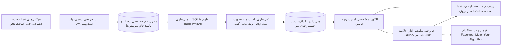

# نقشهٔ راه MJNexus: از توجهِ اینستاگرامی به دانش، الگوریتم و مدیای شخصی

نگارش: ۲۰۲۶-۱۱-۰۷ · وضعیت: پیشنهاد؛ تصمیم‌های بخش ۱۳ با صاحب پروژه است.

## ۱. مسئله، روایت‌شده

اینستاگرام کانال اصلی کشف شما شده است: ابزار و ریپوی تازه برای کار، ایده برای یادگیری در ۱۷ حوزه، و سرگرمی. ولی اینستاگرام برای نگه‌داشتن توجه ساخته شده، نه برای رسیدن به هدف شما. داده‌های خود این پروژه همین را نشان می‌دهند:

- **انباشتِ بیش از توان پردازش.** ۱٬۹۸۶ ذخیره جمع شده که ۱٬۲۷۴ تایش ریل است. ۱٬۰۵۳ ذخیره تقریباً متنی ندارند و دانش واقعی‌شان داخل گفتار و تصویر است. از ریل‌ها فقط ۱۱ تا باز شده‌اند.
- **دنبال‌کردنِ بیش از توان دیدن.** ۹٬۵۰۵ حساب دنبال می‌شود. هیچ انسانی این حجم را نمی‌بیند، پس الگوریتم اینستاگرام تصمیم می‌گیرد چه چیزی جلوی چشم شما بیاید.
- **دانشِ قفل‌شده.** ذخیره‌ها در اپ جست‌وجو نمی‌شوند، به پروژه وصل نمی‌شوند و نمی‌شود به آن‌ها استناد کرد. معلوم نیست کدام ادعا تبلیغ است و کدام ابزار واقعاً به کار پروژه می‌آید.
- **حلقهٔ بازمانده.** ذخیره‌کردن حس پیشرفت می‌دهد، ولی به تصمیم، یادگیری یا ساختن نمی‌رسد. برای ذهنی که توضیح کوتاه و ADHD-پسند می‌خواهد، گره همین‌جاست: دانش باید کوتاه، به‌موقع و قابل‌اقدام برگردد.

آنچه تا امروز ساخته شده ستون فقرات راه‌حل است: هستی‌شناسی و پایگاه دانش، استخراج با مدل زبانی، لایهٔ ویدیو، پیوند به ویکی‌داده، و رادار و گراف عمومی. قدم بعدی رسیدن از «فهرست» به «سیستم» است.

## ۲. هدف، روشن‌شده

**جملهٔ هدف.** یک موتور شخصی و متن‌باز که توجهِ اینستاگرامی را به دانش و تصمیم تبدیل می‌کند:
- هرچه ذخیره، دنبال یا تماشا می‌کنید خودکار ثبت شود.
- متن، گفتار و تصویرش فهمیده شود.
- به ابزارها، مفهوم‌ها، پروژه‌ها و مسیر یادگیری شما وصل شود.
- یک الگوریتمِ مال خودتان، با دلیل، بگوید الان چه چیزی ارزش وقتتان را دارد.

| خروجی | سنجه | امروز | هدف سه‌ماهه |
|---|---|---|---|
| ثبت کامل | سهم ذخیره‌هایی که خودکار وارد مدل می‌شوند | فقط اشتراک‌های DM، دستی | همهٔ ذخیره‌ها، با تأخیر کمتر از ۲۴ ساعت |
| فهم محتوا | سهم ذخیره‌های پراطلاع یا متوسط | ۴۷٪ | دست‌کم ۹۰٪ |
| اتصال | منابعی که هویت وب دارند (سایت رسمی یا ویکی‌داده) | ۲۲۴ | همهٔ منابعی که دست‌کم دو بار ذکر شده‌اند |
| تصمیم و یادآوری | ذخیره‌هایی که به آزمایش، یادگیری یا یادداشت رسیده‌اند | ثبت نمی‌شود | هفته‌ای دست‌کم ۵ مورد |
| کنترل توجه | سهم فید اینستاگرام که از حساب‌ها و موضوع‌های انتخاب خودتان است | نامعلوم | قابل‌اندازه‌گیری و رو به افزایش |

**خارج از هدف:**
- ربات لایک و فالو
- بازنشر محتوای دیگران
- اسکرپ انبوه بیرون از سیگنال‌های خودتان
- فروش داده

**«مدیای شخصی» دو معنا دارد و هر دو در این نقشه هست:**
1. **رژیم رسانه‌ای شخصی:** فید، خلاصه و رادار مخصوص خودتان، بیرون از اپ.
2. **کانال خودتان در اینستاگرام:** محتوای فارسی ساخته‌شده از همین دانش، مثلاً «ابزار هفته»، با ذکر منبع.

## ۳. معماری در یک نگاه



داده در سه لایه نگه داشته می‌شود. لایسنس باز فقط دربارهٔ کد و دادهٔ مشتق است، نه محتوای دیگران:

| لایه | نمونه | کجا | انتشار |
|---|---|---|---|
| خام (خصوصی) | ویدیو و تصویر، پاسخ کامل سرویس‌ها، متن کامل کپشن و ترنسکریپت، سیگنال‌های تماشا | Google Drive خصوصی یا دیسک خودتان | منتشر نمی‌شود |
| مشتق (عمومی) | لینک، خلاصهٔ کوتاه، موجودیت‌ها، شمارش‌ها، شناسهٔ ویکی‌داده | مخزن و سایت | حاشیه‌نویسی‌های خودتان با CC BY 4.0 |
| تصمیم‌های صاحب | ring، پروژه‌ها، یادداشت‌ها | مخزن یا فایل خصوصی | به انتخاب شما |

> **نکته:** الان متن کامل کپشن‌ها (`catalog.tsv`) و ترنسکریپت کامل ۱۱ ریل در مخزن عمومی است. پیشنهاد: متن کامل به لایهٔ خصوصی برود و در مخزن فقط گزیده و لینک بماند. تصمیم با شماست (بخش ۱۳).

## ۴. نقشهٔ داده: چه داریم، چه کم داریم

| داده | برای کدام هدف | امروز | شکاف | بهترین منبع |
|---|---|---|---|---|
| فهرست کامل ذخیره‌ها و کالکشن‌ها | ثبت | ۱٬۹۸۶ اشتراک DM | Saveهای خود اپ و کالکشن‌ها هنوز دیده نشده‌اند | خروجی رسمی: `saved_posts.json` و `saved_collections.json` |
| رسانهٔ ریل‌ها | فهم | ۱۱ ریل | ۱٬۲۶۳ ریل | Apify (لینک رسانه چند ساعت اعتبار دارد، پس دانلود فوری) |
| گفتار | فهم | ۱۱ ترنسکریپت، فارسی ضعیف | کیفیت و پوشش | Whisper فارسی محلی یا Gemini |
| متن روی تصویر و فریم | فهم | ۱۱ ریل | ۵۵۸ پست تصویری کم‌اطلاع و همهٔ ریل‌ها | OCR و مدل بینایی |
| پروفایل حساب‌ها | الگوریتم حساب‌ها | ۱٬۹۳۷ | حدود ۷٬۵۰۰ حساب دنبال‌شده و ۹۲۶ حسابِ صاحب پست | Apify، یا Business Discovery |
| سیگنال توجه | الگوریتم | هیچ | لایک، تماشا، موضوع‌هایی که اینستاگرام به شما نسبت می‌دهد | خروجی رسمی، Watch history، Your Algorithm |
| زمینهٔ بیرونی | رادار | ۲۵۱ صفحه، متادیتای ریپوها، ویکی‌داده | ستارهٔ گیت‌هاب، انتشارها، بحث‌های HN و Reddit | GitHub API با توکن، HN Algolia، agent-reach |
| **دادهٔ خود شما** | **همه** | `projects.tsv` و `radar_owner.tsv` خالی‌اند | پروژه‌ها، اهداف یادگیری، ring ابزارها | خودتان، ماهی ۲۰ دقیقه |

مهم‌ترین شکاف ردیف آخر است. الگوریتمی که پروژه‌ها و اهداف شما را نداند، فقط «پرتکرار» را بالا می‌آورد، نه «مفید برای شما» را.

در خروجی رسمی، فایل‌های «پست‌های دیده‌شده» و «ویدیوهای تماشاشده» فقط نام نویسنده و زمان را دارند و لینک ندارند. پس سیگنال توجه حساب‌محور است، نه پست‌محور. فایل لایک‌ها لینک دارد.

## ۵. روش‌های گرفتن داده: از دستی تا خودکار

هر روش با چهار معیار سنجیده می‌شود: هزینه، ریسک برای حساب، پوشش، و سازگاری با پروژهٔ متن‌باز.

### ۵.۱ دستی
- **Download your information** (Accounts Center ← Your information and permissions ← Download your information، با قالب JSON و بازهٔ All time):
  - یک «فهرست» است، نه پشتیبان: لینک، حساب و زمان ذخیره دارد، ولی رسانه ندارد.
  - لایک‌ها، فهرست دنبال‌شده‌ها، موضوع‌ها و سیگنال‌های تماشا هم در آن هست.
  - ماهی یک بار کافی است.
- **Watch history** (Profile ← Settings ← Your activity ← Watch history):
  - ریل‌هایی که تماشا کرده‌اید. گزارش‌ها می‌گویند فقط ۳۰ روز آخر را نگه می‌دارد.
  - بر اساس حساب مرتب می‌شود.
- **Your Algorithm** (آیکن بالای Reels):
  - موضوع‌هایی را نشان می‌دهد که اینستاگرام فکر می‌کند دوست دارید.
  - هم داده است و هم اهرم کنترل.
  - از دسامبر ۲۰۲۵ در آمریکا عرضه شد و طبق گزارش‌ها از ژانویهٔ ۲۰۲۶ برای کاربران انگلیسی‌زبان در همه‌جا.
- **عادت فعلی:** اشتراک پست در DM حساب دوم، به‌اضافهٔ کالکشن‌هایی با نام پروژه.
- **باارزش‌ترین کار دستی:** تعریف ۵ پروژه و ۳ هدف یادگیری، و تعیین ring برای ۳۰ ابزار برتر.

### ۵.۲ چندتایی
- **Apify روی فهرست لینک‌ها، با سقف هزینه:** همان کاری که `video_pipeline.py` می‌کند. هر ریل حدود ۰٫۰۰۲۶ دلار.
- **افزونه‌های کروم برای خروجی گرفتن از ذخیره‌ها** (مانند Saved Posts Exporter و Saves Exporter): سریع‌اند، ولی کدشان بسته است و به حساب شما دسترسی می‌گیرند. فقط بعد از بررسی.
- **gallery-dl:** روی فهرست لینک‌ها یا کالکشن ذخیره، با کوکی خودتان. لایسنسش GPL-2.0 است، پس فقط به‌عنوان ابزار بیرونی.

### ۵.۳ اسکریپت
- **ابزارهای همین مخزن:** `video_pipeline.py`، `transcribe.py`، `link_entities.py`، `repo_meta.py`.
- **ابزارهای بیرونی، روی دستگاه خودتان و کم‌حجم:**
  - `instaloader :saved` (MIT) با نشست خودتان.
  - `yt-dlp` (Unlicense) برای تک‌ویدیو.

### ۵.۴ خودکار و زمان‌بندی‌شده
- **روتین Claude:** روتین ماهانه الان فعال است و برای صف تازه‌ها می‌تواند هفتگی یا روزانه شود.
- **GitHub Actions** برای کارهایی که کلید و رمز لازم ندارند: ساخت سایت، ویکی‌داده، متادیتای ریپوها.
- **محرک فایل:** گذاشتن خروجی رسمی در یک پوشهٔ Drive، پردازش را راه می‌اندازد.

### ۵.۵ بات (پیشنهاد اصلی برای ثبت لحظه‌ای)
- **بات رسمی DM اینستاگرام:**
  - حساب دوم را حرفه‌ای (Creator) کنید و یک اپ Meta با Messaging API بسازید.
  - وب‌هوک پیام‌ها برای ریل اشتراکی، پیوستی از نوع `ig_reel` با عنوان، URL و شناسهٔ ویدیو می‌فرستد. این از اکتبر ۲۰۲۴ پشتیبانی می‌شود و پست‌ها هم دارند به نوع `ig_post` منتقل می‌شوند.
  - یعنی همان عادت فعلی، بدون اسکرپ، رسمی و لحظه‌ای وارد صف پردازش می‌شود.
  - یک endpoint کوچک لازم دارد، مثلاً Cloudflare Worker رایگان.
  - چون فقط با حساب خودتان کار می‌کند، احتمالاً حالت توسعهٔ اپ کافی است؛ پیش از ساخت بررسی شود.
- **بات تلگرام:** دکمهٔ Share و ارسال به ربات شخصی. ساده‌ترین مسیر برای لینک از هر شبکه‌ای، از جمله یوتیوب، X و گیت‌هاب.
- **میانبر iOS یا Android:** Share Sheet لینک را به همان صف می‌فرستد.

### ۵.۶ API رسمی

| API | چه می‌دهد | محدودیت |
|---|---|---|
| Instagram Platform (رسانه و Insights) | داده و آمار پست‌های حساب حرفه‌ای خودتان | فقط حساب خودتان |
| Content Publishing | انتشار پست، کاروسل و ریل | سقف ۲۴ساعته؛ منابع ۵۰ یا ۱۰۰ می‌گویند، با `content_publishing_limit` بپرسید |
| Business Discovery | متادیتا و رسانهٔ عمومی حساب‌های Business و Creator دیگر | حساب حرفه‌ای و اپ لازم دارد؛ نرخ محدود |
| Hashtag Search | پست‌های یک هشتگ | ۳۰ هشتگ یکتا در هر ۷ روز |
| oEmbed Read | کد جاسازی پست | thumbnail و author_name از نوامبر ۲۰۲۵ حذف شده‌اند |
| Meta Content Library | دادهٔ پژوهشی گسترده | فقط پژوهشگران دانشگاهی و غیرانتفاعیِ تأییدشده، از راه ICPSR؛ حوزه‌های تحریمی مستثنا |

Basic Display API از دسامبر ۲۰۲۴ تعطیل شده است.

### ۵.۷ API سایه (غیررسمی)
- **ابزارها:**
  - `instaloader` (MIT)
  - `instagrapi` (MIT؛ API خصوصی اپ موبایل)
  - `gallery-dl` (GPL-2.0)
  - `yt-dlp`
- **واقعیت‌ها:**
  - همه نشست ورود لازم دارند و با هر تغییر اینستاگرام ممکن است بشکنند.
  - چالش ورود و هشدار مسدودی رایج است؛ issueهای باز instaloader دربارهٔ `:saved` و تهدید به مسدودی را ببینید.
  - اتوماسیون در حالت ورود، خلاف شرایط استفادهٔ اینستاگرام است.
  - در پروندهٔ Meta علیه Bright Data (ژانویهٔ ۲۰۲۴)، دادگاه اسکرپ دادهٔ عمومی در حالت «بدون ورود» را نقض آن شرایط ندانست. ریسک اصلی، اسکرپ در حالت «با ورود» است.
- **توصیه:**
  - روی حساب اصلی نه.
  - اگر لازم شد، فقط برای خواندن فهرست ذخیره‌های خودتان: کم‌حجم، روی دستگاه خودتان، و هرگز داخل مخزن عمومی یا CI.
  - در نسخهٔ متن‌باز فقط به‌صورت افزونهٔ اختیاری و با هشدار.

### ۵.۸ خدمات شخص ثالث

| سرویس | کاربرد | قیمت | نکته |
|---|---|---|---|
| Apify | ریل، پست، پروفایل، کامنت، هشتگ | به ازای هر نتیجه؛ ماهانه ۵ دلار رایگان | لینک رسانه چند ساعته منقضی می‌شود و دیتاست‌های بی‌نام پاک می‌شوند (الان صفر دیتاست در حساب). پس باید فوراً بایگانی کرد. |
| Bright Data | دیتاست و Scraper API | تجاری | طرف پیروز پروندهٔ ۲۰۲۴ |
| HikerAPI | API ابری بر پایهٔ instagrapi | تجاری | ادعای «بدون مسدودی» از خود فروشنده است |
| APIهای غیررسمی RapidAPI | گوناگون | متغیر | ناپایدار |
| Gemini API (فهم مستقیم ویدیو)، OpenAI، Deepgram، AssemblyAI، ElevenLabs Scribe | گفتار و ویدیو | دقیقه‌ای | اول روی نمونهٔ فارسی خودتان بسنجید |

### ۵.۹ ثبت منفعل
- **screenpipe:** صفحه را محلی ضبط و OCR می‌کند و نشان می‌دهد روی دسکتاپ چه دیده‌اید. لایسنسش را بررسی کنید؛ گزارش‌هایی از تغییر به source-available هست.
- **ضبط صفحهٔ گوشی و OCR:** فقط برای نمونه‌گیری.

### ۵.۱۰ زمینهٔ بیرون از اینستاگرام
- GitHub API با توکن: ستاره، انتشارها، topics
- Hugging Face API
- HN Algolia: رایگان و بدون کلید
- Reddit و X از راه agent-reach (نشست ورود لازم دارد)
- یوتیوب: `yt-dlp` برای زیرنویس
- arXiv API
- ویکی‌داده: انجام شده

### ۵.۱۱ آنچه جامعه‌ها پیشنهاد می‌کنند
- **انجمن Privacy Guides:** gallery-dl به‌اضافهٔ خروجی رسمی.
- **Show HN:**
  - InstaSave (سپتامبر ۲۰۲۶)
  - افزونه‌های Saved Posts Exporter و Downloader
  - centralsave و Bookmarq
  - Yakread: RSS reader با یادگیری ماشین؛ الگوی خوبی برای الگوریتم شخصی
  - defeed: جمع‌کنندهٔ متن‌باز فعالیت آنلاین
- **Bluesky feed-generator:** الگوی «الگوریتمی که خودتان میزبانی می‌کنید». سرویس فقط فهرست شناسهٔ پست‌ها را برمی‌گرداند.
- **بوکمارک‌منیجرهای self-hosted:**
  - Karakeep و Linkwarden (AGPL-3.0؛ برچسب‌زنی محلی با Ollama)
  - ArchiveBox (MIT؛ آرشیو کامل صفحه)
- **Reddit و X:** از این محیط مستقیم خوانده نشدند. Reddit جلوی خزندهٔ این محیط را می‌گیرد و agent-reach نشست ورود می‌خواهد. با نشست خودتان می‌شود جست‌وجوی هدفمند کرد.

### ۵.۱۲ انتخاب برای هر نیاز

| نیاز | انتخاب اول | جایگزین | پرهیز |
|---|---|---|---|
| فهرست ذخیره‌ها | خروجی رسمی ماهانه | بات DM رسمی برای تازه‌ها | instaloader روی حساب اصلی |
| رسانهٔ ذخیره‌ها | Apify با سقف هزینه | gallery-dl با کوکی، کم‌حجم | افزونه‌های ناشناس |
| گفتار | Whisper فارسی روی GPU | Gemini یا API دیگر | Whisper small روی CPU برای فارسی |
| متن تصویر | OCR به‌اضافهٔ بینایی Claude یا Gemini | مدل بینایی محلی | |
| پروفایل‌ها | Apify، تدریجی با اعتبار رایگان | Business Discovery | اسکرپ با ورود |
| سیگنال توجه | خروجی رسمی و Watch history | screenpipe | |

## ۶. پردازش: از پست خام تا دانش

| مرحله | کار | ابزار و لایسنس |
|---|---|---|
| ۱. شناسه و یکتاسازی | یکی کردن نسخه‌های تکراری و بازنشرها | shortcode؛ هش ادراکی تصویر با imagehash (BSD) |
| ۲. گفتار | ترنسکریپت فارسی و انگلیسی | faster-whisper (MIT) با large-v3-turbo (MIT) یا مدل فارسی‌شده: BuzzASR/persian (WER گزارش‌شده ۱۴٫۴۵٪)، vhdm/whisper-large-fa-v1، wav2vec2-xlsr-persian-v3. روی ۲۰ ریل خودتان مقایسه شود و لایسنس وزن‌ها بررسی شود. |
| ۳. فریم و متن روی صفحه | برگهٔ فریم‌ها و OCR | ffmpeg scene detection (موجود)؛ Tesseract (Apache-2.0، دادهٔ fas)؛ PaddleOCR (Apache-2.0)؛ یا مدل بینایی. Surya (GPL) فقط بیرونی. |
| ۴. فهم با مدل زبانی | خلاصه، منابع، ادعا، دسته | همان `BRIEF.md` با خروجی ساختاریافته؛ دو مرحله: مدل محلی ارزان برای دسته‌بندی و Claude برای موارد سخت؛ Batch API برای هزینه |
| ۵. هویت موجودیت | سایت رسمی و ویکی‌پدیا | ویکی‌داده (انجام شده)، GitHub، Hugging Face |
| ۶. بردار و جست‌وجو | جست‌وجوی معنایی فارسی و انگلیسی | BGE-M3 (MIT)، multilingual-e5 (MIT)؛ تصویر: SigLIP 2 (Apache-2.0)؛ ذخیره: sqlite-vec (MIT/Apache) کنار FTS5 |
| ۷. موضوع‌یابی | کشف خوشه‌ها و وصل کردن به گره‌های ویکی | BERTopic (MIT)، UMAP و HDBSCAN (BSD) |
| ۸. ادعا و تبلیغ | تشخیص هایپ و راستی‌آزمایی | ادعاها استخراج شده‌اند؛ نشانه‌های هایپ: «کامنت بگذار»، «لینک در بیو»، صفت عالی؛ تطبیق با README و بنچمارک |
| ۹. هوش حساب‌ها | امتیاز هر حساب | ویژگی‌های بخش ۷.۴ |
| ۱۰. زمان | روند و حساب‌های پیشرو | `first_seen` هر ابزار در هر حساب؛ سرعت روند؛ چه کسی اول خبرش را داده |

## ۷. الگوریتم شخصی: پیش‌بینی و رتبه‌بندی

### ۷.۱ چه چیزی پیش‌بینی شود
1. **ارزش یک ذخیره برای همین الان:** برای برگرداندنش به جلوی چشم شما.
2. **پیشنهاد ring برای هر ابزار:** تصمیم نهایی با شماست.
3. **ارزش هر حساب:** برای Favorites، Mute یا Unfollow.
4. **روند:** کدام ابزار و موضوع رو به اوج است.
5. **قدم بعدی یادگیری:** در درخت ویکی.

### ۷.۲ سیگنال‌ها

| نوع | نمونه |
|---|---|
| صریح | ring، یادداشت، «در پروژه استفاده شد»، پسندیدم و نپسندیدم در خلاصه |
| ضمنی، قوی | ذخیره، اشتراک در DM، افزودن به کالکشن |
| ضمنی، متوسط | لایک |
| ضمنی، ضعیف | تماشای بدون ذخیره (فقط در سطح نویسنده) |
| منفی | Not interested، آنفالو، رد کردن در خلاصه |

### ۷.۳ نردبان مدل: از ساده و شفاف شروع کن
- **L0 قاعده و فیلتر:** همین که الان هست.
- **L1 فرمول وزن‌دار شفاف:** وزن‌ها در یک فایل `weights.yaml` نگه داشته می‌شوند تا خودتان عوضشان کنید.

  ```
  امتیاز = 0.30 × تناسب با پروژه و هدف (شباهت برداری)
         + 0.20 × کیفیت شاهد (سطح اطلاع، ادعای تأییدشده)
         + 0.15 × اعتبار حساب
         + 0.15 × تازگی (نیمه‌عمر ۳۰ روز)
         + 0.10 × سرعت روند
         + 0.10 × تازگی برای شما (چیزی که هنوز بلد نیستید)
         − جریمهٔ هایپ − جریمهٔ ریسک
  ```

- **L2 یادگیری رتبه‌بندی:** بعد از حدود ۲۰۰ بازخورد؛ اول رگرسیون لجستیک، بعد LightGBM LambdaRank (MIT).
- **L3 اکتشاف:** Thompson sampling برای ۱۰ تا ۲۰ درصد موارد، تا در حباب نمانید.
- **L4 بازرتبه‌بندی با مدل زبانی:** فقط روی ۲۰ مورد برتر، همراه با توضیح «چرا این؟».

**گاردریل‌ها:**
- تنوع با MMR
- حداکثر ۲ مورد از هر حساب
- سهمیه برای حوزه‌ها
- سقف ۷ مورد در روز (ضد غرق شدن در اسکرول)

**سنجش:**
- **آفلاین:** NDCG@10 و recall@k روی بازخوردهای شما.
- **آنلاین:** نرخ «نگه داشتم» یا «اقدام کردم» در خلاصه‌ها.
- **ماهانه:** بازبینی وزن‌ها.

### ۷.۴ الگوریتم حساب‌ها و فرمان به اینستاگرام
اینستاگرام اجازه نمی‌دهد الگوریتمش را جایگزین کنید، ولی می‌شود از بیرون هدایتش کرد.

**ویژگی‌های هر حساب:**
- نسبت ذخیره به تماشا (از فایل تماشاهای حساب‌محور)
- تراکم شاهد
- نسبت پست‌های «کامنت بگذار تا لینک بفرستم»
- پیشرو بودن در معرفی ابزارها
- تمرکز موضوعی
- هم‌پوشانی با حساب‌های دیگر

**خروجی ماهانه، یک چک‌لیست:**
- ۵۰ حساب برای Favorites
- پیشنهادهای Mute و Unfollow
- موضوع‌های پیشنهادی برای Your Algorithm
- نمودار «شکاف الگوریتم»: موضوع‌هایی که اینستاگرام به شما نسبت می‌دهد، در برابر اهداف خودتان

اعمال این‌ها در اپ را دستی و توسط خودتان پیشنهاد می‌کنم. فالو و آنفالوی خودکار حساب را در خطر مسدودی می‌اندازد.

## ۸. تجسم

| سؤال | نما | ابزار |
|---|---|---|
| کدام ابزار برای کار؟ | رادار (موجود)، با حرکت ماهانه بین حلقه‌ها | d3 (ISC) |
| همه‌چیز چطور به هم وصل است؟ | گراف (موجود)، با خوشه‌بندی و لغزندهٔ زمان | Sigma.js و Graphology (MIT) برای گراف‌های بزرگ |
| نقشهٔ کنجکاوی من چیست؟ | اطلس معنایی: نقشهٔ UMAP همهٔ ذخیره‌ها، رنگ بر اساس حوزه | deck.gl (MIT) یا Observable Plot (ISC) |
| علاقه‌هایم چطور عوض می‌شود؟ | Stream graph موضوع‌ها در طول زمان | Observable Plot، ECharts (Apache-2.0) |
| کی و چطور ذخیره می‌کنم؟ | Calendar heatmap و دوره‌های ذخیرهٔ پشت‌سرهم | Observable Plot |
| کدام حساب‌ها ارزش دارند؟ | ماتریس حساب × موضوع؛ جدول حساب‌های پیشرو | ECharts |
| انباشت چقدر جلو رفته؟ | قیف: ذخیره ← پردازش ← اتصال ← آزمایش ← استفاده | d3 |
| اینستاگرام مرا چطور می‌بیند؟ | نمودار شکاف الگوریتم | Observable Plot |

برای انتشار جدول‌های خام SQLite به‌صورت مرورپذیر: Datasette (Apache-2.0). برای صفحه‌های گزارش از Markdown: Evidence (MIT).

## ۹. مدیای شخصی

**الف) رژیم رسانه‌ای خودتان:**
- **روزانه:** خلاصهٔ «۷ مورد» در تلگرام، ایمیل یا سایت.
- **هفتگی:** رادار، با آنچه بین حلقه‌ها جابه‌جا شده.
- **ماهانه:** چک‌لیست تنظیم الگوریتم اینستاگرام.
- **کارت‌های یادگیری:** خلاصهٔ ELI5 و ADHD-پسند برای هر گره ویکی، با مرور فاصله‌دار.
- **خلاصهٔ صوتی فارسی:** برای وقت رفت‌وآمد.
- **فهرست پخش ریل‌ها:** فقط با لینک، بدون بازنشر.

**ب) کانال خودتان در اینستاگرام:**
- **مسیر:** قالب کاروسل فارسی «ابزار هفته» ← رندر با Playwright (موجود) ← انتشار با Content Publishing API ← آمار با Insights API ← بازخورد به الگوریتم.
- **قاعده‌ها:**
  - ذکر منبع و لینک
  - بدون آپلود دوبارهٔ ویدیوی دیگران
  - هر ادعا با شاهد

## ۱۰. لایسنس باز و مرز داده‌ها
- **کد:** MIT (فعلی). Apache-2.0 هم اگر بند حق اختراع مهم شد.
- **سیاست وابستگی‌ها:**
  - در هسته فقط MIT، BSD، Apache، ISC و Unlicense.
  - GPL و AGPL فقط به‌صورت ابزار بیرونی یا افزونهٔ اختیاری؛ مثل gallery-dl، Surya، Karakeep.
- **وزن مدل‌ها:** جدا بررسی شوند. Whisper، BGE-M3 و SigLIP لایسنس باز دارند؛ Llama و Gemma شرایط اختصاصی دارند؛ Qwen در نسخه‌های کوچک Apache است ولی هر وزن را باید جدا دید.
- **داده:**
  - محتوای دیگران متعلق به خودشان است و خام منتشر نمی‌شود.
  - حاشیه‌نویسی‌های خودتان با CC BY 4.0 یا CC0.
  - داده‌های ویکی‌داده CC0 هستند.
- **«خروجی خودت را بیاور»:** نسخهٔ متن‌باز روی خروجی رسمی هر کاربر اجرا شود. دمو فقط دادهٔ مشتقِ شما یا نمونهٔ ساختگی را نشان دهد.
- **حقوقی، در یک خط:** اتوماسیون با ورود خلاف شرایط اینستاگرام است. اسکرپ دادهٔ عمومی بدون ورود در یک پروندهٔ آمریکایی نقض آن شرایط شناخته نشد. حق نشر رسانه‌ها با سازندگان است. درخواست حذف در `DATA.md` تعریف شده است.

## ۱۱. سه رویکرد

| رویکرد | چه می‌کند | هزینه | ریسک | پوشش |
|---|---|---|---|---|
| **الف. رسمی و سبک** | خروجی رسمی ماهانه، بات DM رسمی، Apify فقط برای ذخیره‌های تازه، پردازش محلی | حدود ۵ دلار در ماه (اعتبار رایگان) | کم | همهٔ ذخیره‌ها به‌صورت فهرست، و رسانهٔ ذخیره‌های تازه |
| **ب. ترکیبی (پیشنهاد)** | الف، به‌اضافهٔ پرکردن یک‌بارهٔ رسانهٔ همهٔ ذخیره‌های گذشته، یک دورهٔ کوتاه GPU برای گفتار، و Gemini یا Claude برای بینایی | یک‌بار حدود ۲۰ تا ۴۰ دلار، بعد حدود ۵ دلار در ماه | کم | تقریباً کامل |
| **ج. حداکثری** | API سایه برای ذخیره‌ها، فید و پست‌های تازهٔ حساب‌ها، هر روز | پایین به‌اضافهٔ زمان نگه‌داری | بالا: مسدودی، شکستن، شرایط استفاده | کامل، ولی شکننده |

رسانهٔ همهٔ ریل‌های فعلی، با تعرفهٔ فعلی Apify، تقریباً در اعتبار رایگان یک ماه جا می‌شود (حدود ۳٫۳ دلار برای ۱٬۲۶۳ ریل). گلوگاه واقعی زمان پردازش است.

## ۱۲. نقشهٔ راه

| فاز | کار | خروجی | سنجه |
|---|---|---|---|
| ۰. فوری | بایگانی دادهٔ خام فعلی (۱۰۹ مگابایت پاسخ خام Apify و رسانهٔ ۱۰ ریل، که فقط در محیط موقت مانده‌اند) در Drive خصوصی؛ درخواست خروجی رسمی JSON | بایگانی خصوصی، فایل خروجی | هیچ دادهٔ خامی از بین نرود |
| ۱. دو هفته | ورود خروجی رسمی: ذخیره‌ها، کالکشن‌ها، لایک‌ها، دنبال‌شده‌ها، موضوع‌ها، تماشاها؛ موجودیت‌های تازهٔ Collection، Signal و IGTopic در هستی‌شناسی | ذخیره‌های کامل در مدل | پوشش فهرست ۱۰۰٪ |
| ۲. از ۹ نوامبر | رسانهٔ ریل‌ها و پست‌های کم‌اطلاع؛ مقایسهٔ سه مدل گفتار فارسی؛ OCR و بینایی؛ استخراج | لایهٔ ویدیو و تصویر | سهم پراطلاع یا متوسط به بیش از ۸۰٪ برسد |
| ۳. | بات DM رسمی یا تلگرام؛ پردازش روزانه | ثبت لحظه‌ای | تأخیر کمتر از ۲۴ ساعت |
| ۴. | الگوریتم v1 (فرمول وزن‌دار)، دکمه‌های بازخورد، خلاصهٔ روزانه، امتیاز حساب‌ها و چک‌لیست Favorites | فید شخصی | نرخ «اقدام کردم» |
| ۵. | اطلس معنایی، stream graph، حرکت رادار با عکس‌های ماهانه | نماهای تازه در سایت | استفادهٔ هفتگی |
| ۶. | کانال شخصی (کاروسل فارسی و انتشار رسمی)؛ بسته‌بندی متن‌باز: CLI، راهنمای «خروجی خودت را بیاور»، دادهٔ نمونه، بررسی لایسنس‌ها | نسخهٔ عمومی | یک نفر دیگر بتواند اجرایش کند |

## ۱۳. تصمیم‌های شما
1. **بایگانی خصوصی:** دادهٔ خام و رسانه در Google Drive خصوصی ذخیره شود؟ فوری است، چون محیط فعلی موقت است.
2. **بات DM رسمی:** حساب دوم حرفه‌ای شود و یک اپ Meta ساخته شود؟ یا بات تلگرام کافی است؟
3. **بودجه:** فقط اعتبار رایگان (الف) یا یک‌بار حدود ۲۰ تا ۴۰ دلار (ب)؟
4. **API سایه:** نه (پیشنهاد)، یا فقط افزونهٔ اختیاری روی دستگاه خودتان؟
5. **مدیای شخصی:** فقط رژیم رسانه‌ای، یا کانال خودتان هم؟
6. **متن کامل کپشن‌ها و ترنسکریپت‌ها:** به لایهٔ خصوصی منتقل شوند؟
7. **دادهٔ خودتان:** ۵ پروژه، ۳ هدف یادگیری، و ring برای ۳۰ ابزار برتر.

اگر پرداخت یا ثبت‌نام در سرویسی برایتان محدودیت منطقه‌ای دارد، مسیرهای محلی و متن‌باز (Whisper محلی، OCR محلی، بات تلگرام) جلو می‌افتند.

## منابع
- [Instagram Saved Posts guide (saved_posts.json, saved_collections.json)](https://contextbolt.com/blog/instagram-saved-posts/)
- [DTI: Instagram "Download your information" for viewed posts and videos](https://portmap.dtinit.org/articles/watch-history1.md)
- [TechCrunch: Instagram's "Your Algorithm"](https://techcrunch.com/2025/12/10/instagrams-new-your-algorithm-tool-gives-you-more-control-over-the-reels-you-see)
- [Engadget: Your Algorithm topics](https://www.engadget.com/social-media/instagram-will-let-you-control-which-topics-its-algorithm-recommends-133002612.html)
- [TechCrunch: Watch history for Reels](https://techcrunch.com/2025/10/24/instagrams-latest-feature-lets-you-go-back-see-your-watched-reels/)
- [Meta: Webhooks for Instagram Messaging](https://developers.facebook.com/docs/instagram-messaging/webhooks)
- [Meta: Instagram Messaging changelog](https://developers.facebook.com/documentation/business-messaging/instagram-messaging/changelog/)
- [Meta: Hashtag Search](https://developers.facebook.com/documentation/instagram-platform/instagram-api-with-facebook-login/hashtag-search.md)
- [Meta: oEmbed updates (April 2025)](https://developers.facebook.com/blog/post/2025/04/08/oembed-updates/)
- [Meta Content Library and API](https://transparency.meta.com/researchtools/meta-content-library)
- [ICPSR access to Meta API products](https://www.icpsr.umich.edu/sites/icpsr/news/icpsr-to-facilitate-researcher-access-to-metas-api-products)
- [Meta v. Bright Data ruling (TechCrunch)](https://techcrunch.com/2024/01/24/court-rules-in-favor-of-a-web-scraper-bright-data-which-meta-had-used-and-then-sued)
- [Instaloader issues](https://github.com/instaloader/instaloader/issues/1411)
- [Privacy Guides: downloading Instagram saves](https://discuss.privacyguides.net/t/how-do-i-download-all-my-saves-from-instagram/16231.md)
- [gallery-dl releases](https://github.com/mikf/gallery-dl/releases?page=4)
- [BuzzASR/persian](https://huggingface.co/BuzzASR/persian), [vhdm/whisper-large-fa-v1](https://huggingface.co/vhdm/whisper-large-fa-v1)
- [Self-hosted bookmark managers](https://contextbolt.com/blog/best-self-hosted-bookmark-managers/)
- [Bluesky feed generator](https://www.bskyinfo.com/sdks/bluesky-social-feed-generator/)
- [screenpipe](https://screenpi.pe/about)
- [Content publishing limits (third-party summary)](https://bundle.social/blog/instagram-api-rate-limits)
- Show HN: [InstaSave](https://insta-saved.gitnasr.com/)، [Yakread](https://yakread.com/)، [defeed](https://defeed.co)

## ۱۴. بازبینی پس از نقد (۲۰۲۶-۱۱-۰۷)
پیشنهادهای بالا یک‌به‌یک با قوی‌ترین اعتراض سنجیده شدند و صاحب پروژه با نتیجه موافقت کرد. اصل راهنما: **اول استفاده، بعد زیرساخت.** معیار موفقیت، تعداد تصمیم و اقدام واقعی است، نه تعداد مورد پردازش‌شده.

| تصمیم | حکم | چه چیزی نظر را عوض کرد |
|---|---|---|
| راهبرد کلی | اول استفاده | خطر تبدیل شدن پروژه به لوله‌کشیِ بی‌استفاده |
| بودجه | پردازش سریع، ولی بدون خرید | هزینهٔ کل صف (حدود ۱٬۲۶۳ ریل و ۵۵۸ پست کم‌اطلاع) حدود ۴٫۳ تا ۴٫۸ دلار است و در اعتبار رایگان ماهانه جا می‌شود |
| بایگانی دادهٔ خام | اول استخراج، بعد کنار گذاشتن | کمینه‌سازی داده؛ ویژگی‌های ۱٬۹۵۸ حساب در `instagram-index/analysis/account_features.tsv` استخراج شد |
| بات DM رسمی | حذف (فعلاً) | حساب حرفه‌ای نمی‌تواند خصوصی باشد؛ ثبت لحظه‌ای برای رادار لازم نیست |
| API سایه | دریافت رسانه افزونه‌پذیر | پیش‌فرض Apify بدون ورود؛ بقیه اختیاری و روی دستگاه خود کاربر |
| گفتار فارسی | فقط برای حدود ۹۰ ریل فارسی | فقط حدود ۷٪ ریل‌ها کپشن فارسی دارند؛ ترنسکریپت انگلیسی با Whisper small خوب است |
| دادهٔ صاحب پروژه | انتخاب از پیشنهادها، نه فرم | `projects.tsv` و `radar_owner.tsv` خالی مانده بودند؛ ۱۰ پروژهٔ احتمالی در `knowledge/data/project_candidates.tsv` |
| الگوریتم | پروژه‌محور، با توضیح Claude | با این حجم، «برای پروژهٔ X چه دارم» از فید عمومی مفیدتر است؛ سقف روزانه پیش‌فرض است، نه قانون |
| هدایت اینستاگرام | ۵۰ Favorites و موضوع‌های Your Algorithm | ۷۱٪ ذخیره‌ها از ۷۷۷ حساب (۸٪ دنبال‌شده‌ها)؛ ۲۹٪ از پیشنهادهای اینستاگرام؛ فهرست در `instagram-index/analysis/favorites_candidates.tsv` |
| متن کامل | کپشن عمومی می‌ماند؛ ترنسکریپت کامل خصوصی | ریسک DMCA برای کل مخزن و سایت با بزرگ شدن حجم |
| کانال شخصی | عقب افتاد | خطر برگشت به تلهٔ توجه |
| لایسنس | MIT می‌ماند | انتخاب ارزشی؛ AGPL هم قابل‌دفاع است |

**برنامهٔ دو هفته:**
1. صاحب پروژه ۱ تا ۳ پروژه را از `project_candidates.tsv` انتخاب می‌کند.
2. برای هر پروژه یک «برگهٔ تصمیم» ساخته می‌شود: ابزارها، شاهد، لایسنس، فعالیت، پیشنهاد.
3. کار زمان‌بندی‌شدهٔ روزانه، رسانهٔ ریل‌ها و پست‌های کم‌اطلاع را با اعتبار رایگان پردازش می‌کند (`video_pipeline.py`، `BRIEF.md`، `check_media.py`).
4. صاحب پروژه یک بار ۵۰ حساب Favorites و موضوع‌های Your Algorithm را تنظیم می‌کند.

معیار: دست‌کم ۵ تصمیم واقعی در دو هفته.
